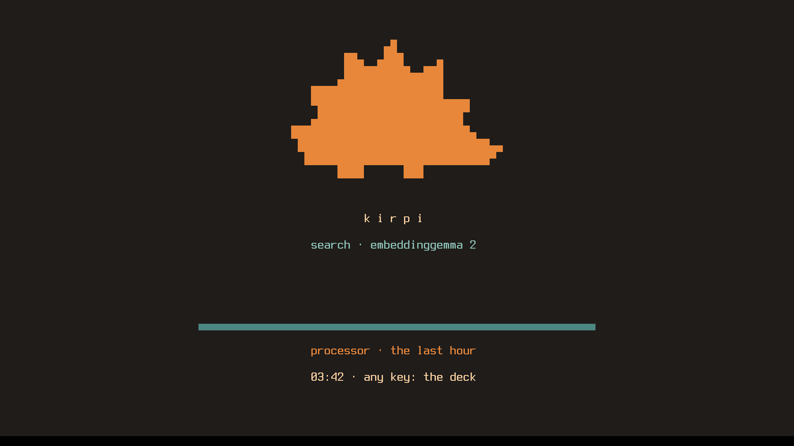
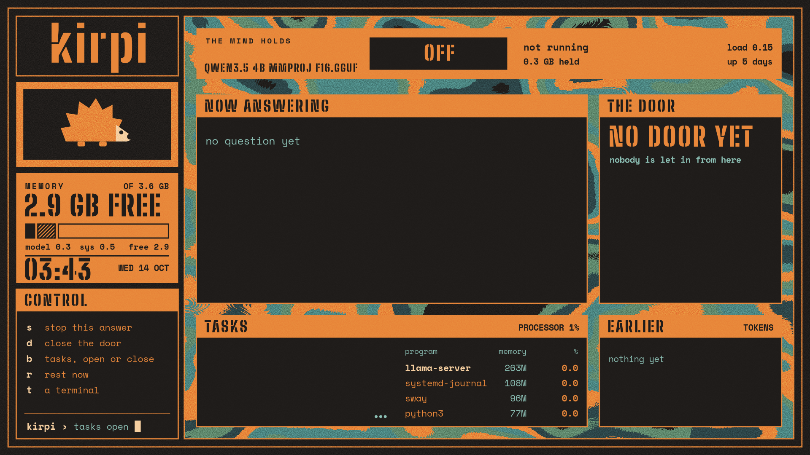

# Kirpi rice

A resting screen on the plain text console and a full-screen deck for a small machine that is always on.
Built for a Lenovo V15-IIL running Debian 13 with no desktop; nothing in it is tied to that model. Orange, teal and soot with film grain, a
hedgehog, stencil lettering: the look of a record sleeve. The resting screen needs no graphics at all: 2 MB,
backlight low, drawn with a console font that has two extra glyphs.

It was made for one machine of [Kimera](https://github.com/burakTanBilgi/Kimera), a project that puts idle
computers to work. The look stands on its own; nothing here needs Kimera.

## Screens

| | |
|---|---|
|  | **Resting.** The first console, read from the machine's framebuffer. A hedgehog in half blocks, the jobs, the processor over the last hour, the clock. Any key opens the deck. |
|  | **The deck.** Drawn by the deck's own program (`kimera-deck-panel --png`) at 1920 x 1080: the local model and what it is answering, memory, the clock, the keys. |
|  | **Tasks open.** `b` on the deck lists the busiest programs. |

After five minutes without a key the deck closes and the machine rests again. The pictures show the deck one key short: `o` (shut down) was added after they were taken.

## What is here

| Path | What it is |
|---|---|
| `kimera-rest`, `kimera-rest.service` | The resting screen, a shell script on the first console. Each file in `/run/kimera/jobs/` is one job; its first line is shown. |
| `kirpi-32x16.psf.gz`, `make-font.py` | The console font: Debian's Terminus Bold 32x16 (`Lat15-TerminusBold32x16.psf.gz`, package `console-setup-linux`) with the pilcrow and the section sign replaced by the two half blocks, and the script that makes it. |
| `rest-install.sh`, `login-install.sh`, `kimera-rest-login.sh` | Install the resting screen, then put the password login back in front of it. |
| `deck/kimera-deck-panel` | The deck (Python, GTK 3, cairo), drawn over the still artwork. |
| `deck/make-art.py`, `deck/marks.py`, `deck/kirpi-deck.svg`, `deck/kirpi-deck.png` | The artwork. `make-art.py` (run inside `deck/`) writes the SVG; the PNG is that SVG rendered at 1920 x 1080 with grain added. |
| `deck/deck.sway`, `deck/foot.ini`, `deck/kimera-deck`, `deck/deck-install.sh` | sway holds one window; the installer puts everything in place. |
| `awake-install.sh` | The machine never sleeps, lid closed or not. |
| `kimera-poweroff`, `poweroff-install.sh` | One user may power the machine off or restart it without sudo, and nothing else. |

## Install

On a fresh Debian 13 with no desktop, with sudo from your own user, from this folder:

```sh
sudo sh rest-install.sh
sudo sh login-install.sh
sudo sh poweroff-install.sh YOUR_USER
sudo sh deck/deck-install.sh
```

Read each script first; they are short and say what they change. Things to know before you run them:

- **Run `login-install.sh` right after `rest-install.sh`.** `rest-install.sh` alone starts your session on the
  first console with no password: any key opens the deck and `t` opens a shell. `login-install.sh` puts the
  password login back in front of it.
- After `login-install.sh` the first console asks for your password and then shows the resting screen in place
  of a shell; a shell is `t` on the deck, or the second console (Ctrl+Alt+F2).
- To go back: `sudo sh login-install.sh --undo` returns to the resting screen without a password; then
  `sudo systemctl disable --now kimera-rest.service && sudo systemctl enable --now getty@tty1.service` returns to
  Debian's plain login.
- The installers replace their own files in `/usr/local/bin`, `/etc/kimera` and `/etc/systemd/system` on every
  run, without keeping the old ones.
- `rest-install.sh` and `login-install.sh` add your user to the `video` group (for the backlight).
- `poweroff-install.sh` lets that one user power off and restart without a password, over ssh too and also
  while others are logged in. The deck's `o` key needs it. It needs polkit (`apt install polkitd`).
- The scripts install from Debian's own archive: brightnessctl, sway, swayidle, foot, the GTK and cairo
  bindings the deck's program needs, and two tools for the deck's terminal, grim (screenshots) and btop.

- `awake-install.sh` is optional and for a machine that stays plugged in on a desk: a laptop that cannot sleep
  gets hot in a bag. Its header says how to undo it.

The deck shows a local model served by llama.cpp on `127.0.0.1:8080` when there is one ("the mind", with the
model file it finds under `~/kimera/models`), and says so plainly when there is not. "The door" is a panel for
who may send it questions; without Kimera it stays "no door yet".

## Keys on the deck

`s` stop this answer, `d` close the door, `b` tasks, `r` rest now, `t` a terminal, `o` shut down (asks first).

## Fonts and licences

- Scripts and programs: [MIT](LICENSE).
- The artwork (`deck/kirpi-deck.svg`, `deck/kirpi-deck.png`, `screens/`): [CC BY 4.0](LICENSE-ART.md).
- Big Shoulders Stencil and Space Mono, in `deck/fonts/`: SIL Open Font License, the texts are beside them.
- `kirpi-32x16.psf.gz` is made from Terminus Font by `make-font.py`: SIL Open Font License 1.1, see `OFL-Terminus.txt`.

Designed and directed by Burak Tan Bilgi. Built and tested with AI coding agents. Results reviewed by him.
